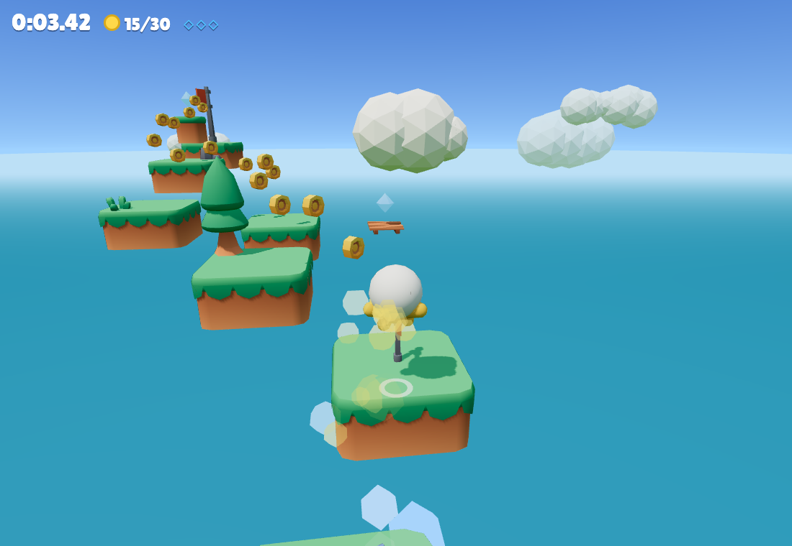

# World Jumping

A 3D platformer in the browser: run and jump from island to island up to the flag. Works on desktop and phones, free and open source.

**Play:** https://andreaacanfora.github.io/world-jumping/ (preview) · https://andreaaca.altervista.org/platform3D/



World Jumping started in 2018 as a first-person game built on Three.js r71. Version 2 is a full rewrite: hand-made levels instead of random ones, a real physics engine, a character you can see, touch controls and a test suite that plays every level.

## How to play

| | Keyboard and mouse | Phone |
|---|---|---|
| Move | WASD or arrows | left joystick |
| Look around | mouse | drag on the right |
| Jump (hold for higher) | Space | green button |
| Turbo | Shift | » |
| Jetpack (hold) | E | ▲ |
| Magic block under your feet | Q | ◆ |
| First or third person | C | Settings |
| Pause | Esc | II |

Gamepads work too.

Each level has a gold, silver and bronze time, coins along the jumps and three hidden gems. Turbo, jetpack and the magic block have limited charges per level.

## Level design rules

Version 1 placed platforms at random, and the 2026 rework drew heights up or down at random. Too often the player went downhill, or a single long drop reached the flag. Version 2 levels are designed by hand and checked by the tests:

- every jump on the main route goes up or stays level;
- every jump stays within 70% of what the physics allows, so it is comfortable, not pixel-perfect;
- jumps that need an ability (turbo, jetpack, spring) are marked and checked against that ability;
- an autopilot plays each level with the real physics in the browser (`e2e/levels.spec.ts`); a level it cannot finish fails CI.

Levels live in `src/levels/`, written as a sequence of jumps:

```ts
route([0, 0, 0], 'block-grass-overhang-large', [
  { d: [0, 1.5, 3.6] },              // next island: 1.5 up, 3.6 ahead
  { d: [0, 0, 6.0], needs: 'dash' }, // a gap you can only clear with the turbo
]);
```

## Development

```bash
npm install
npm run dev         # http://localhost:5174
npm test            # movement, level and medal rules
npm run typecheck
npx playwright test # the autopilot finishes every level; menus on desktop and mobile
```

`?autopilot` in the URL makes the game play itself.

```
src/player/movement.ts   jump, run, coyote time, jump buffering, turbo, jetpack (pure, unit tested)
src/player/Player.ts     Rapier character controller, moving platforms, springs, animations
src/level/               level format, runtime, reachability checks
src/levels/              the levels
src/camera/              third and first person camera
src/input/               keyboard, mouse, gamepad, touch
src/ui/                  menus, HUD, Italian and English
src/debug/Autopilot.ts   plays a level for the tests
```

## Deployment

GitHub Actions run the tests on every push, publish a preview on GitHub Pages and upload the build to Altervista over FTPS (`.github/workflows/altervista.yml`, needs the `ALTERVISTA_FTP_PASSWORD` secret).

## Support

If you enjoy the game, you can [support it on PayPal](https://www.paypal.me/AndreaAca). Contributions are welcome: open an issue or a pull request.

## License

Code: MIT. Assets: CC0, see [CREDITS.md](CREDITS.md).
